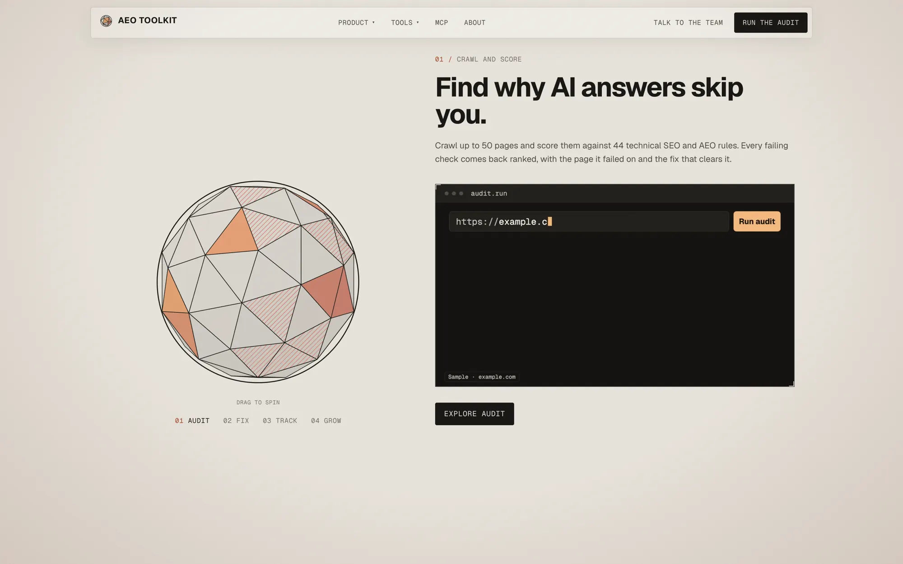
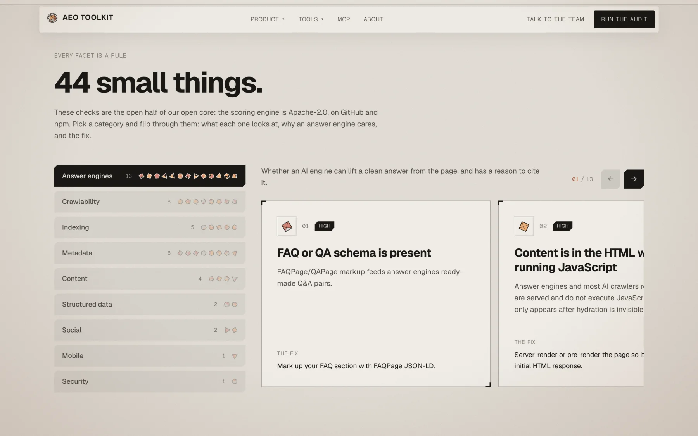
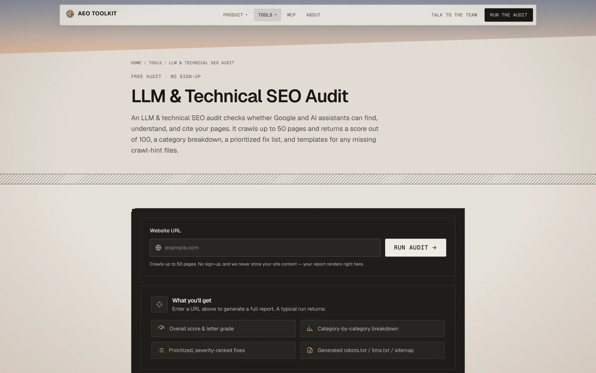
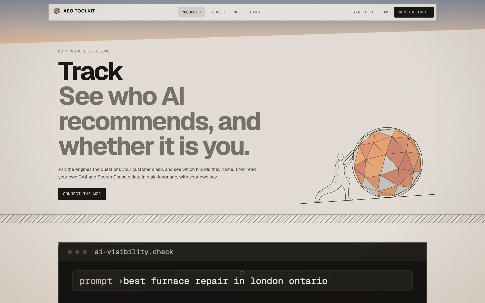
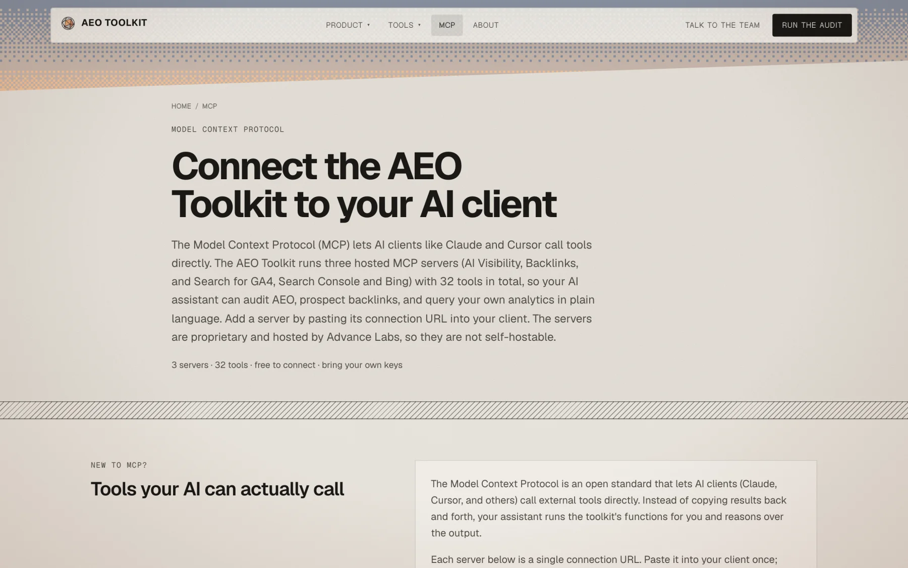

<div align="center">


# AEO Toolkit

**The next big thing will be a lot of small things.**

Open-source AI search optimization: 44 small checks that decide whether ChatGPT, Claude and Perplexity cite you.

<a href="https://advancelabs.dev/tools"></a>

[](https://typescriptlang.org)
[](LICENSE)
[](https://advancelabs.dev)
[](brand/README.md)
[](https://chromewebstore.google.com/detail/aeogeo-auditor/bdkkjpbipgolopjhndknigaaokdabnad)

</div>

> Open-source TypeScript packages for **Answer Engine Optimization (AEO)**, Generative Engine Optimization (GEO), and AI citation visibility. Contributions welcome — see [CONTRIBUTING.md](CONTRIBUTING.md).

> **Open core.** This repo is the open-source half of the AEO Toolkit: the audit engine, crawler,
> parser, schema validator and the Chrome extension, all Apache-2.0 and published to npm. The
> hosted platform behind [advancelabs.dev/tools](https://advancelabs.dev/tools) and the three
> MCP servers (the console, OAuth, billing, the Google and Bing integrations) moved to a
> private repository on 2026-10-20. Code published here before that date stays Apache-2.0.

**Try it without installing anything:** the six browser tools run free in the browser at
**[advancelabs.dev/tools](https://advancelabs.dev/tools)** — no sign-up, no account.
Point the auditor at a URL and it returns a weighted, per-rule report in about a minute.
Want it done for you? Advance Labs runs a [monthly AEO retainer](https://advancelabs.dev/services/ai-visibility).

The hosted side is **six browser tools** (technical audit, E-E-A-T scan, llms.txt generator,
GA4 + GSC chat, backlink graph, authority) and **three MCP servers** (`ai-visibility`, `backlink`,
`search`) exposing 32 tools to Claude or any MCP client. They are proprietary and run on
advancelabs.dev. This repo is the open core: the audit engine packages, the
[Chrome extension](apps/chrome-extension) and the [skills](skills). See
[`docs/reference/tools.md`](docs/reference/tools.md) for the full map.

---

## What it looks like

The hosted site is a faceted sphere in which every facet is one of the audit's small checks.

| | |
|---|---|
|  |  |
| **Crawl and score.** Up to 50 pages against every rule. | **44 small things.** Each check is open source. |
|  |  |
| **The audit tool.** Free, no sign-up. | **Track.** See who AI recommends. |



---

## What is AEO?

**Answer Engine Optimization (AEO)** is the practice of structuring your content so that AI assistants — ChatGPT, Perplexity, Claude, Gemini — cite your site when answering questions in your domain. Traditional SEO gets you ranked on the blue-link results page. AEO gets you *quoted* in the AI answer.

As AI-powered search becomes the default discovery layer, AEO is the new SEO.

---

## The audit

The hosted technical audit runs **44 checks** (31 technical SEO + 13 AEO) across crawlability,
AI-bot access, structured data, metadata and answer readiness, scored out of 100, with a prioritised
fix list and templates for any crawl-hint file you're missing. The E-E-A-T scan is a separate
tool that scores **14 signals**. The engine defines 58 in total (44 + 14), but the audit itself
runs 44. Free, no account, and your data stays yours.

---

## The Chrome extension

**[AEO/GEO Auditor](https://chromewebstore.google.com/detail/aeogeo-auditor/bdkkjpbipgolopjhndknigaaokdabnad)** puts the same engine on your toolbar. Open any page, click the icon, and get a 0 to 100 AI-readiness score with a letter grade and a list of what to fix. Export it as a PDF.

It runs `auditRules` from [`packages/scoring/src/audit.ts`](packages/scoring/src/audit.ts): **44 checks across 9 categories** (31 technical-SEO + 13 AEO) from extension 0.3.0, built on scoring 0.3.x. The Chrome Web Store build before that (0.2.0) ran 40, so the listing changes when 0.3.0 is published. The 14 E-E-A-T signals are a separate scorer the extension does not run, 58 is the engine total (44 + 14), not what any one audit runs.

Everything happens in your browser. No account, no server, no analytics, no telemetry. The only network requests are to the audited site's own `robots.txt`, `sitemap.xml`, and `llms.txt`, which is what the host permission is for. Nothing is stored, because nothing is sent.

- **Install:** [Chrome Web Store](https://chromewebstore.google.com/detail/aeogeo-auditor/bdkkjpbipgolopjhndknigaaokdabnad)
- **About:** [advancelabs.dev/tools/aeo-auditor](https://advancelabs.dev/tools/aeo-auditor)
- **Source:** [`apps/chrome-extension`](apps/chrome-extension) · [publishing runbook](apps/chrome-extension/CHROME_STORE.md)

Build it yourself:

```bash
pnpm --filter @advance-labs/chrome-extension package
# → apps/chrome-extension/aeo-extension.zip, loadable via chrome://extensions (Developer mode → Load unpacked, on dist/)
```

---

## Packages

| Package | Description |
|---------|-------------|
| [`@advance-labs/crawler`](packages/crawler) | Multi-threaded web crawler with robots.txt compliance, sitemap parsing, and per-host rate limiting |
| [`@advance-labs/html-parser`](packages/html-parser) | Extracts meta tags, Open Graph, Twitter Cards, headings, images, links, and JSON-LD from HTML |
| [`@advance-labs/schema-validator`](packages/schema-validator) | Validates Schema.org JSON-LD structured data against known types |
| [`@advance-labs/scoring`](packages/scoring) | Scores pages on 44 technical SEO and AEO checks, plus a separate 14-signal E-E-A-T scorer, with per-rule explanations |

Plus [`@advance-labs/net-guard`](packages/net-guard) and [`@advance-labs/types`](packages/types). The one
application here is [`apps/chrome-extension`](apps/chrome-extension); the hosted console is not open source.

---

## Quick Start

Six packages are published to npm and usable on their own:

```bash
npm i @advance-labs/scoring      # the 44-check audit engine
npm i @advance-labs/net-guard    # SSRF-safe fetch: re-checks every redirect hop
npm i @advance-labs/crawler      # polite crawler with robots.txt + rate limiting
npm i @advance-labs/html-parser
npm i @advance-labs/schema-validator
npm i @advance-labs/types        # shared types, a dependency of the above
```

> The hosted tools at [advancelabs.dev/tools](https://advancelabs.dev/tools) need no install at all.

```bash
git clone https://github.com/Advance-Labs/aeo-toolkit.git
cd aeo-toolkit
pnpm install
pnpm build          # turbo builds every package
pnpm test           # the full suite, no network
```

Read the full documentation at **[docs.advancelabs.dev/aeo-toolkit](https://docs.advancelabs.dev/aeo-toolkit)**.

Once built, the packages compose like this:

```js
import { crawl } from '@advance-labs/crawler'
import { parseHtml } from '@advance-labs/html-parser'
import { analyzeStructuredData } from '@advance-labs/schema-validator'
import { buildAuditReport } from '@advance-labs/scoring'

const result = await crawl('https://example.com/', { maxPages: 2 })
const html = result.pages.filter((p) => p.ok && p.body && p.contentType?.includes('html'))

const report = await buildAuditReport(
  {
    crawl: result,
    pages: html.map((p) => parseHtml(p.body, p.finalUrl)),
    structuredData: html.map((p) => analyzeStructuredData(p.body, p.finalUrl)),
    mode: 'full-site',
  },
  { durationMs: 0, version: '1.0.0' },
)

console.log(report.url, report.score.overall, report.score.grade)
console.log(report.topFixes.slice(0, 3).map((f) => f.title))
```

---

## Connect the MCP servers

The three MCP servers are **hosted, not installed**. They are Streamable-HTTP endpoints, so there is
nothing to `npm install` and no local process to run — point any MCP client at the URL.

**Claude Code** — one command per server:

```bash
claude mcp add --transport http --scope user aeo-visibility https://aeo.advancelabs.dev/api/mcp/ai-visibility/mcp
claude mcp add --transport http --scope user aeo-backlink   https://aeo.advancelabs.dev/api/mcp/backlink/mcp
claude mcp add --transport http --scope user aeo-search     https://aeo.advancelabs.dev/api/mcp/search/mcp
```

Drop `--scope user` to register them in the current project only. Check the result with
`claude mcp list`.

**Claude.ai / Claude Desktop** — Settings → Connectors → Add custom connector, then paste the URL.

**Cursor** (`~/.cursor/mcp.json`), Windsurf, or any client that takes a JSON block:

```json
{
  "mcpServers": {
    "aeo-visibility": { "url": "https://aeo.advancelabs.dev/api/mcp/ai-visibility/mcp" },
    "aeo-backlink":   { "url": "https://aeo.advancelabs.dev/api/mcp/backlink/mcp" },
    "aeo-search":     { "url": "https://aeo.advancelabs.dev/api/mcp/search/mcp" }
  }
}
```

| Server | Tools | Credentials |
|---|---|---|
| `aeo-visibility` | 5 | None to connect. Citation checks take a Perplexity key per request. |
| `aeo-backlink` | 7 | None. |
| `aeo-search` | 20 | Sign in with Google: the client opens a browser on first use (in Claude Code, `/mcp` → Authenticate). Or BYOK: a Google access token as `Authorization: Bearer`, plus an optional `x-bing-api-key`. |

Three things that trip people up:

- **The trailing `/mcp` is required.** The bare `/api/mcp/<slug>` returns the adapter's own
  "Not found", which looks like a routing bug and is not.
- **Only `aeo-search` has a login, and its discovery is path-scoped.** It answers an anonymous
  request with a 401 pointing at `/.well-known/oauth-protected-resource/api/mcp/search/mcp`; its
  authorization server is `/api/mcp/oauth`. The ROOT `/.well-known/oauth-*` documents deliberately
  return 404, because `aeo-visibility` and `aeo-backlink` need no login.
- **Every tool is read-only.** None calls a write method on any upstream API.

`/api/mcp/ga-gsc/mcp` still works as a compatibility alias for `aeo-search`; new configs should use
`/api/mcp/search/mcp`.

---

## Why AEO?

When a user asks ChatGPT "what is the best tool for X?", the answer comes from indexed content that AI models trust — not from ad-auction bidding. The trust signals for AI citation are:

- **Structured data** (JSON-LD `Organization`, `FAQPage`, `HowTo`)
- **`llms.txt`** — the AI equivalent of `robots.txt`
- **Canonical, server-rendered HTML** — AI crawlers prefer static content
- **Topical authority** — consistent, in-depth coverage of a topic

AEO Toolkit automates auditing all of these.

---

## Monorepo Structure

```
aeo-toolkit/
├── packages/          # the six published libraries, plus shared config
├── apps/chrome-extension/
├── apps/docs/         # Astro + Starlight docs site (renders ../../docs)
├── docs/              # the documentation itself
└── brand/             # the mark, lockups, palette and type (brand/README.md)
```

Built with [Turborepo](https://turbo.build) · TypeScript 5 · Vitest · React 19

---

## Design

Advance Labs' products follow one visual system: a near-black ground, a single acid-green signal
colour, mono lab-sheet labels, Syne headlines, and the Advance Labs sphere as the mark. The
palette, type, tokens and rules are in [`brand/README.md`](brand/README.md), with the assets
beside it. Anything a user sees should follow it, and
[`docs/CONVENTIONS.md`](docs/CONVENTIONS.md#design-and-brand) says how in code.

---

## Made by Advance Labs

Built and maintained by [Advance Labs](https://advancelabs.dev) · [All Advance Labs products](https://advancelabs.dev/lab)

AEO Toolkit is built and maintained by **[Advance Labs Inc.](https://advancelabs.dev)** — a software studio building [Creatin](https://www.creatin.ca), [Cartrix](https://www.cartrix.live), and this toolkit.

This project dogfoods its own tooling: `advancelabs.dev` ships with `llms.txt`, JSON-LD Organization schema, SSG-rendered pages, and canonical URLs — all patterns the scoring engine teaches.

---

## Code of Conduct

We follow the [Contributor Covenant](https://www.contributor-covenant.org/version/2/1/code_of_conduct/) — be respectful and constructive in all project spaces, and report unacceptable behavior to [conduct@advancelabs.dev](mailto:conduct@advancelabs.dev).

---

<sub>© 2026 Advance Labs Inc. — <a href="https://advancelabs.dev">advancelabs.dev</a></sub>
