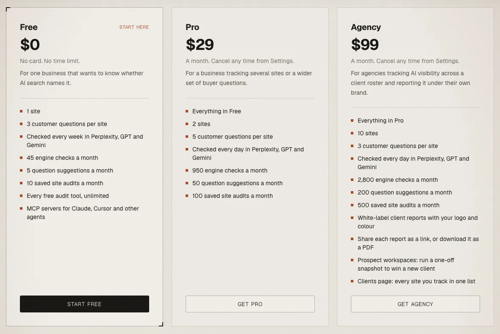
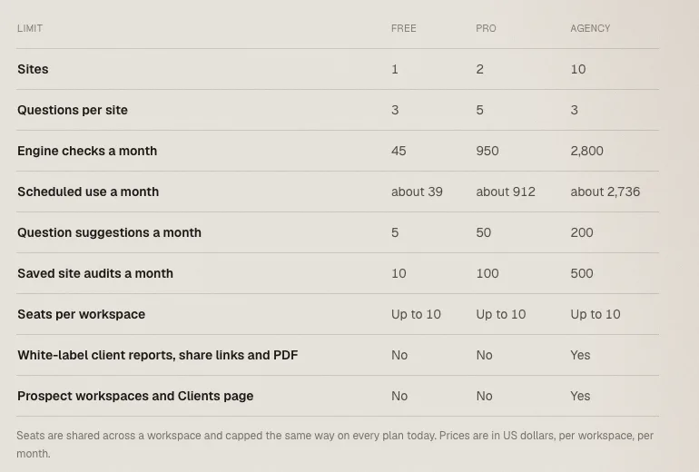

The dashboard asks your buyer questions of AI engines on a schedule and records whether you are named. This tour uses only public material: a sample workspace shown on the [MCP page](https://aeo.advancelabs.dev/mcp), the [sample audit](https://aeo.advancelabs.dev/tools/audit/sample) and the [pricing page](https://aeo.advancelabs.dev/pricing). It does not show a real account. The product changes, so treat the live pages as the authority.

## The sample workspace

The frame below is from the walkthrough video on the MCP page. The workspace is called Acme Studio and the domains use `.example`, so nothing in it is real customer data.

### The sidebar

| Section | Item | What it is for |
|---|---|---|
| Home | Overview | The workspace at a glance |
| Visibility | Results | Who the engines named for your questions |
| Visibility | Prompts | The buyer questions you track |
| Visibility | Competitors | The other domains you track against |
| Act | Audits | Saved site audits |
| Act | Tools | The audit tools |
| Connect | MCP | Connection details for your AI client |
| Account | Settings | Plan and connections |

### Results

The ranking lists each domain, a label (You, Competitor or Editorial) and how many of the answers named it. In the sample, `acme.example` is named in 12 of 24 answers, 50 percent. A competitor is named in 13 of 24.

### Runs from your MCP client

The lower panel, **From your MCP client**, lists checks you ran from Claude or Cursor with the [aeo-toolkit server](where-to-find-and-install.md). Each row shows the question and, per engine, whether the brand was named and linked. These are kept apart from the scheduled numbers above them, which cover dashboard runs only.

## Plans and limits

On 2026-11-17 the pricing page listed these limits.

Two ideas explain the table.

- **One check is one question asked of one engine.** The engines are Perplexity, GPT and Gemini. A scheduled question uses three checks per run. Free runs weekly and Pro and Agency run daily.
- **Allowances reset on the 1st of each month, UTC.**

Agency adds white-label client reports, shared as a link or a PDF, prospect workspaces for one-off snapshots and a Clients page that lists every site in one place. Seats are shared across a workspace.

## Where the audit fits

The dashboard keeps saved site audits, and each plan caps how many you can save a month. The free tool runs the 44-check engine. The [sample report](https://aeo.advancelabs.dev/tools/audit/sample) shows the finished layout, including the before and after view. [Reading your audit report](reading-your-audit-report.md) explains the numbers on it.

## What this tour does not cover

It does not show the Settings screens, the project connections for Google and Bing, or billing. Those need an account, and this page was written without one. Sign in and open Settings to see them.
