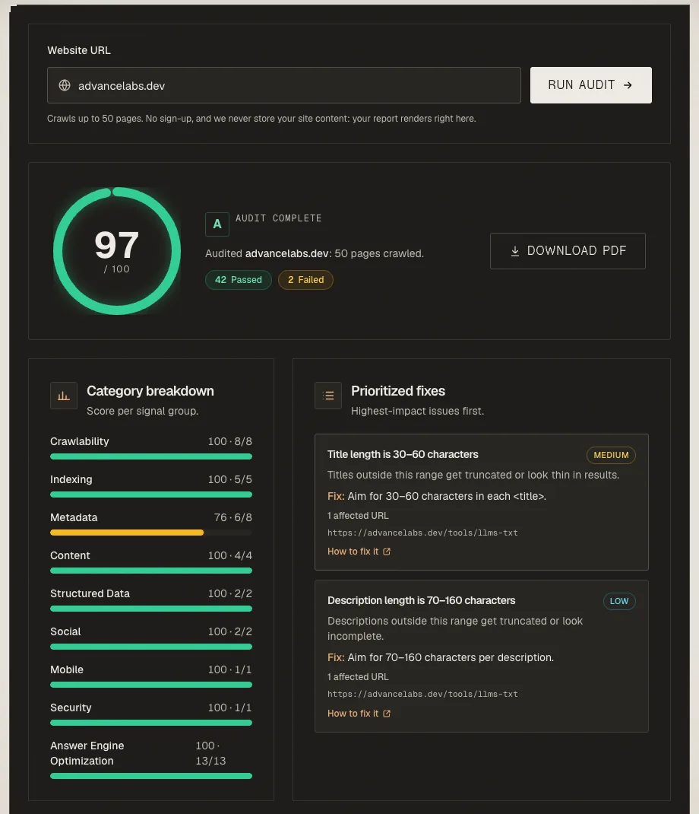
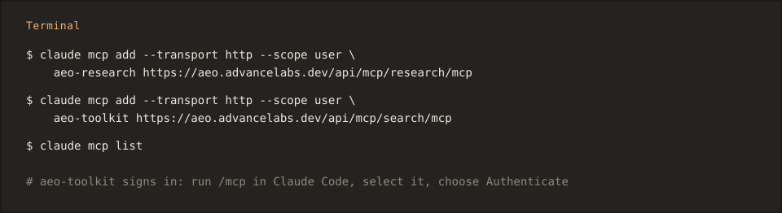
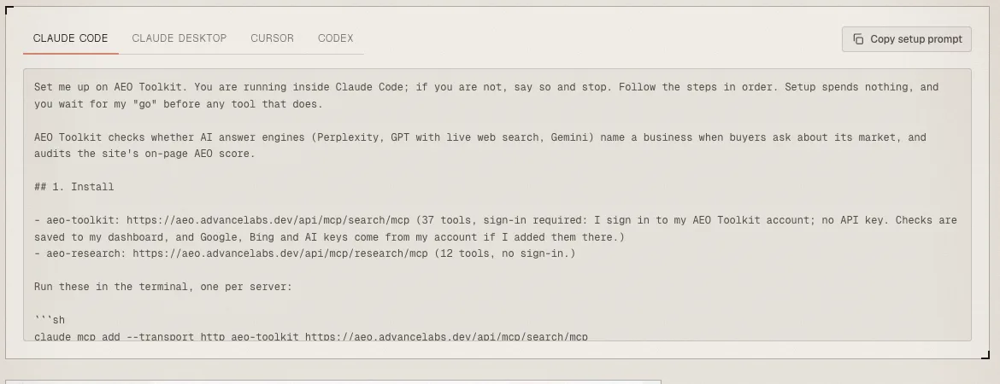

You will run one free audit, connect one MCP server and ask it a question. You need a site URL and, for steps 2 and 3, Claude Code. Nothing here needs an account until step 4.

## 1. Run a free audit

Open the [LLM and technical SEO audit](https://aeo.advancelabs.dev/tools/audit). Type your domain and select **Run audit**. There is no sign-in. It crawls up to 50 pages and renders the report on the page.



You get a score out of 100, a grade, a score per category and a fix list. [Reading your audit report](reading-your-audit-report.md) explains each part. To see what a finished report looks like before you run one, open the [sample report](https://aeo.advancelabs.dev/tools/audit/sample).

## 2. Add the research server

The **aeo-research** server needs no sign-in. Run this in a terminal:

```bash
claude mcp add --transport http --scope user aeo-research https://aeo.advancelabs.dev/api/mcp/research/mcp
```

The `/mcp` at the end of the URL is required. Check the result with `claude mcp list`.



Prefer to let your agent do it? The [MCP page](https://aeo.advancelabs.dev/mcp) has a setup prompt per client. Paste it in and the agent adds the servers and checks the connection.



## 3. Make a first call

Ask your agent:

> Run analyze_website_aeo on https://example.com and tell me the three fixes that matter most.

`analyze_website_aeo` crawls 10 pages and returns a score and at most 8 fixes. It is a shortlist, not the full audit. Use the hosted audit from step 1 when you need every rule.

## 4. Add the account server

The **aeo-toolkit** server reads your Search Console, GA4 and Bing data and saves AI visibility checks to your dashboard. It needs an AEO Toolkit account.

```bash
claude mcp add --transport http --scope user aeo-toolkit https://aeo.advancelabs.dev/api/mcp/search/mcp
```

In Claude Code, run `/mcp`, select **aeo-toolkit** and choose **Authenticate**. A browser opens for sign-in. Then ask the agent to call `list_workspaces`. That call is read-only and confirms the connection.

If the connection fails, see [Troubleshooting MCP connections](troubleshooting-mcp.md).

## 5. Install the skills

```bash
/plugin install aeo-toolkit --marketplace Advance-Labs/aeo-toolkit
```

The plugin adds 24 skills that tell an agent how to fix what an audit finds. Ask it to "do AEO on" your site and the `aeo` skill orders the work. The plugin registers its own copies of both servers, so remove any you added by hand first, or you will see duplicate tools.

## Where next

- [Where to find and install AEO Toolkit](where-to-find-and-install.md) covers Claude.ai, ChatGPT, Cursor and the Chrome extension.
- [Use cases](../use-cases/README.md) shows seven jobs, each with the tools to call.
- [Dashboard tour](dashboard-tour.md) shows what the hosted dashboard contains.
