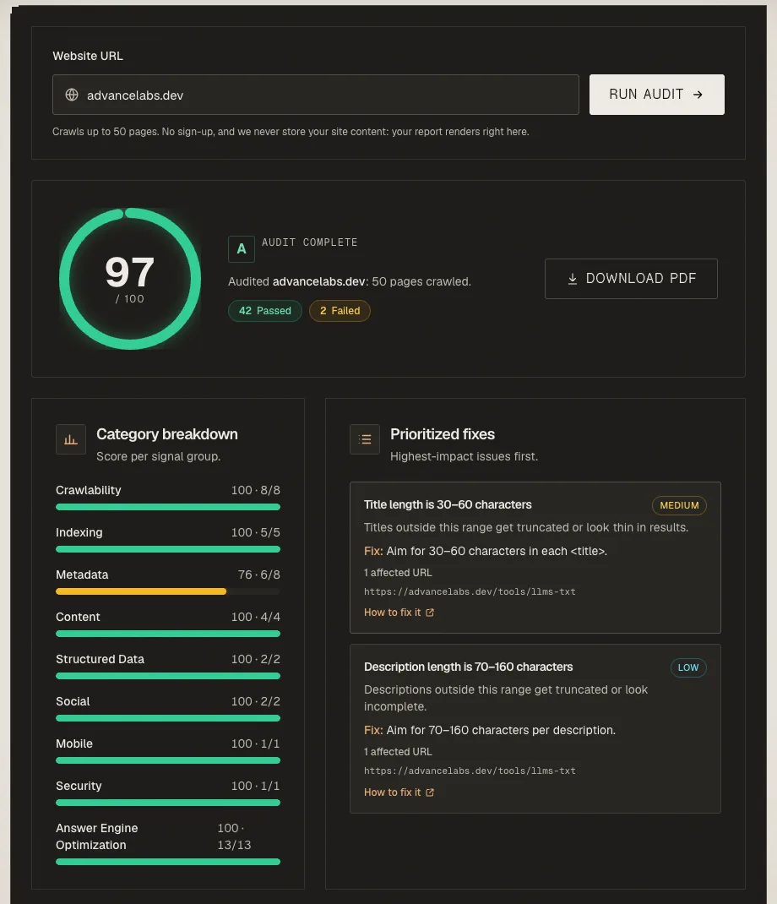
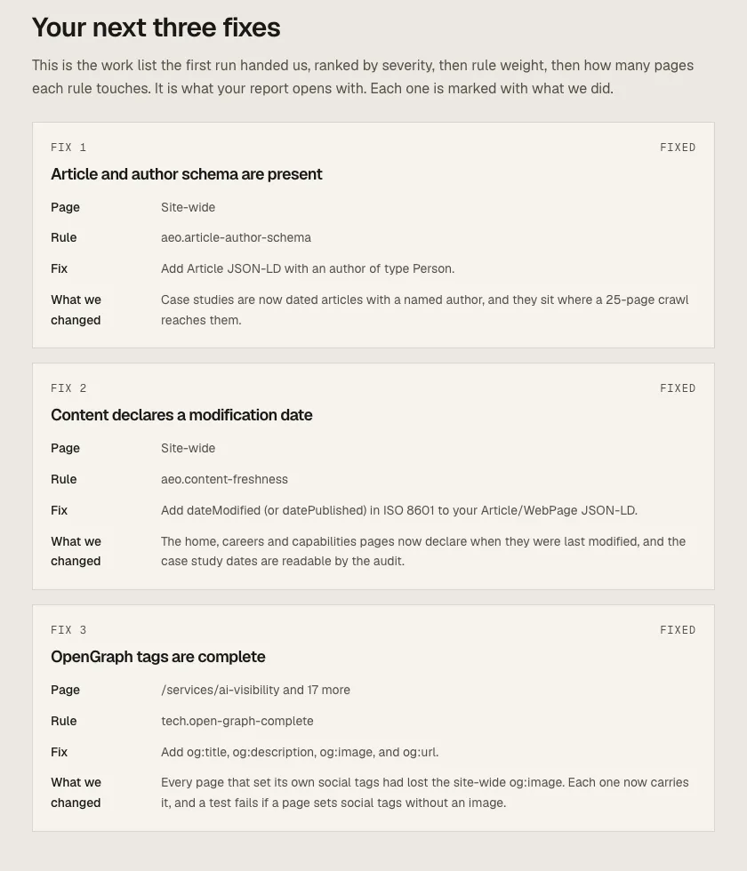
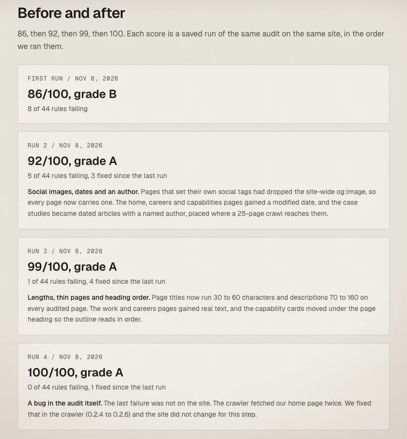

The audit runs 44 checks and turns them into one score. This page explains every number in the report. The source of truth is [`packages/scoring`](../../packages/scoring/README.md), and the numbers below come from it.

## From rules to a score

Every check is a rule. A rule passes or fails, and each carries a **weight** from 2 to 9. Heavier rules matter more.

1. **Category score** is the weight of the passing rules divided by the weight of all rules in the category, times 100. In the report above, Metadata shows `76` and `6/8`: six of eight rules passed, and the two that failed carried 24 percent of the category's weight.
2. **Overall score** is the weighted mean of the category scores. A category counts as much as the total weight of its rules, so a category with many heavy rules pulls the score harder.
3. The overall score is **rounded once**, and the grade is read from the rounded number. The grade can never disagree with the score you see.

A category with no weighted rules scores 100. A rule that throws an error counts as a failure, so one broken rule cannot crash the audit.

## The grade

| Score | Grade |
|---|---|
| 90 to 100 | A |
| 80 to 89 | B |
| 70 to 79 | C |
| 60 to 69 | D |
| Below 60 | F |

## The nine categories

The 44 checks sit in nine categories. The counts below are from a live run on 2026-11-17, and they add up to 44.

| Category | Rules | What it covers |
|---|---|---|
| Crawlability | 8 | robots.txt, sitemap, llms.txt, redirects, broken pages |
| Indexing | 5 | indexable pages, canonicals, hreflang, unique titles |
| Metadata | 8 | titles, descriptions, one H1, heading order, language, charset |
| Content | 4 | thin pages, headings present, image alt text, internal links |
| Structured Data | 2 | structured data present and valid |
| Social | 2 | Open Graph and Twitter cards |
| Mobile | 1 | viewport |
| Security | 1 | HTTPS |
| Answer Engine Optimization | 13 | AI crawler access, answer-first content, schema for answers |

Of the 44, 31 are technical rules and 13 are AEO rules. The full list, with the fix for each, is under [Audit rules](../rules/technical-seo.md). The E-E-A-T scan is separate. It has 14 signals and does not change this score. The engine runs 58 checks in total.

## The fix list

Failed rules become fixes. They are sorted by **severity**, from `critical` down through `high`, `medium` and `low` to `info`. Rules of equal severity sort by weight, heaviest first. Work the list from the top.

The report also counts **critical issues**. That count is the failed rules with `critical` or `high` severity.

Each fix names the rule ID, such as `aeo.article-author-schema`, the affected URLs and a how-to link. The rule ID is the stable handle. Use it to find the owning skill or to ask an agent to fix exactly that rule.

## What changes the result

- **Noindex pages are left out.** Rules that judge page quality skip pages you have asked search engines not to index.
- **Not applicable means no weight.** A rule that does not apply to your site adds no pass and no fail. It does not inflate the score.
- **Single-page mode.** The Chrome extension audits one page. Rules that need a crawl, such as title uniqueness across pages, are skipped instead of failing.
- **The crawl limit.** The hosted audit reads up to 50 pages. A large site is sampled. Fix the pages the crawl reached, then re-run.

## What a score does not tell you

A score lists known causes of being skipped or misread by search and answer engines. It does not measure whether anyone cites you. Tracking does that. See [Dashboard tour](dashboard-tour.md).

## A worked example

The team ran the audit on its own site and fixed what it listed. The score moved from 86 to 92 to 99 to 100 over four runs on the same day. The last failure was a bug in the crawler, not the site.

Read the full [sample report](https://aeo.advancelabs.dev/tools/audit/sample). It shows every finding before and after.
