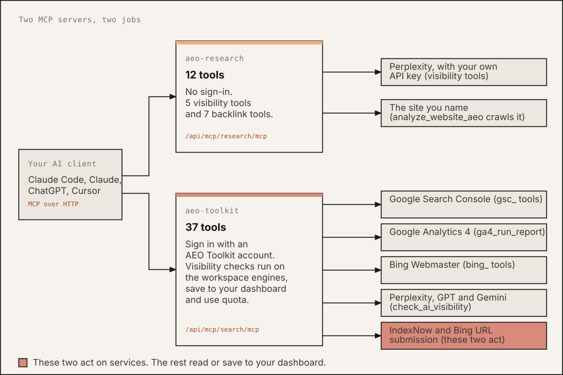
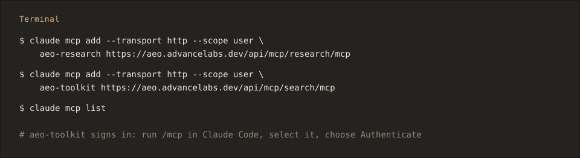
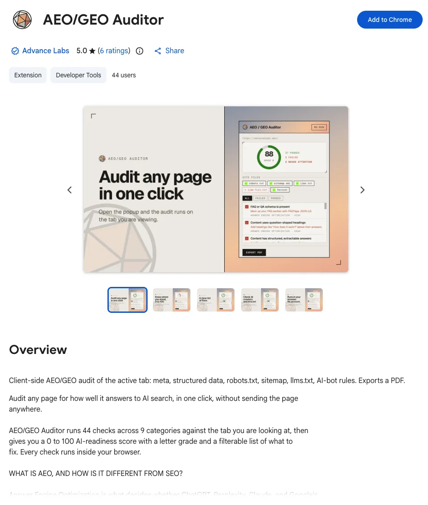

AEO Toolkit runs two public MCP servers. Both are hosted, so nothing installs locally. Point your client at the URL.

| Server | Registry entry | Endpoint | Tools | Access |
|---|---|---|---|---|
| aeo-research | `dev.advancelabs/aeo-research` 1.0.0 | `https://aeo.advancelabs.dev/api/mcp/research/mcp` | 12 | No sign-in. 5 visibility tools and 7 backlink tools. |
| aeo-toolkit | `dev.advancelabs/aeo-search` 1.0.3, titled "AEO Toolkit" | `https://aeo.advancelabs.dev/api/mcp/search/mcp` | 37 | Sign in with an AEO Toolkit account. Google and Bing come from the account's project connections. |

The trailing `/mcp` is required. The registry entry for aeo-toolkit keeps the name `aeo-search` because it kept the original URL.



## Where it is listed

| Directory | Status on 2026-11-17 |
|---|---|
| [Official MCP Registry](https://registry.modelcontextprotocol.io/v0/servers?search=dev.advancelabs) | Both records are live. |
| Glama | Connector pages exist for [aeo-research](https://glama.ai/mcp/connectors/dev.advancelabs/aeo-research) and [aeo-search](https://glama.ai/mcp/connectors/dev.advancelabs/aeo-search). |
| MCP Market | The GitHub repository is in the free review queue. It is not listed yet. |
| [Chrome Web Store](https://chromewebstore.google.com/detail/aeogeo-auditor/bdkkjpbipgolopjhndknigaaokdabnad) | The AEO/GEO Auditor extension is live. |

More directories are in progress. We list one here only after it shows the entry.

The older registry entries `aeo-visibility` and `aeo-backlink` are aliases marked as moved to `aeo-research`. They are not separate products.

To check the registry yourself:

```bash
curl -s "https://registry.modelcontextprotocol.io/v0/servers?search=dev.advancelabs"
```

## Install by client

### Claude Code, servers only

```bash
claude mcp add --transport http --scope user aeo-research https://aeo.advancelabs.dev/api/mcp/research/mcp
claude mcp add --transport http --scope user aeo-toolkit https://aeo.advancelabs.dev/api/mcp/search/mcp
```



Drop `--scope user` to register a server for the current project only. Check with `claude mcp list`. For aeo-toolkit, run `/mcp`, select it and choose **Authenticate**. A browser opens for AEO Toolkit sign-in.

### Claude Code, servers plus 24 skills

```bash
/plugin install aeo-toolkit --marketplace Advance-Labs/aeo-toolkit
```

The plugin registers its own copies of both servers. If you added them by hand, remove those first to avoid duplicate tools.

### Claude.ai and Claude Desktop

Open **Settings, Connectors, Add custom connector**. Paste a server URL from the table above.

### ChatGPT

Turn on developer mode, then add each server by URL as a custom connector.

### Cursor and other clients

Edit `~/.cursor/mcp.json`. Windsurf and other clients that take a JSON block use the same shape.

```json
{
  "mcpServers": {
    "aeo-research": { "url": "https://aeo.advancelabs.dev/api/mcp/research/mcp" },
    "aeo-toolkit": { "url": "https://aeo.advancelabs.dev/api/mcp/search/mcp" }
  }
}
```

The aeo-toolkit server answers an anonymous request with a 401 that points the client at its sign-in. A client without MCP sign-in cannot use it.

### Chrome extension

Install [AEO/GEO Auditor](https://chromewebstore.google.com/detail/aeogeo-auditor/bdkkjpbipgolopjhndknigaaokdabnad) from the Chrome Web Store. See the [extension page](../reference/chrome-extension.md).



## Where the keys come from

On aeo-research, the Perplexity-backed tools take your own Perplexity key on each call. `generate_outreach_email` takes your own model provider key. On aeo-toolkit, Google, Bing and AI provider keys come from your account, so you do not paste a key into chat.

## Next

- [Use cases](../use-cases/README.md) show what to do once it is connected.
- [Buyer questions](buyer-questions.md) answers price, data and sign-in questions.
- [Install the AEO MCP servers from the MCP Registry](../reference/mcp-registry-install.md) has the full registry reference.
