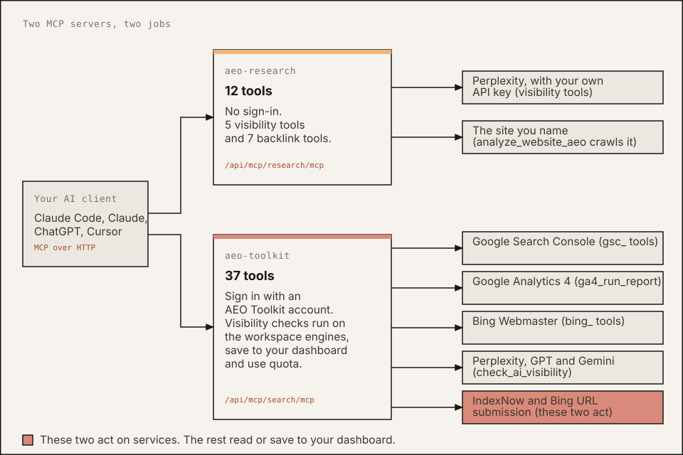

Each page names who the job is for, the real tool and skill names, the steps, and what comes back.

There are two MCP servers. **aeo-research** needs no sign-in. **aeo-toolkit** needs an AEO Toolkit account and reads Google and Bing data from the connections on your project. Setup is in [Where to find and install AEO Toolkit](../guides/where-to-find-and-install.md).

| Job | Server | Page |
|---|---|---|
| Run AEO audits for clients | aeo-research, plus the hosted dashboard | [Agency client audits](agency-client-audits.md) |
| Check whether Perplexity cites you, against competitors | aeo-research | [Perplexity citations vs competitors](perplexity-citations-vs-competitors.md) |
| Find out why organic traffic dropped | aeo-toolkit | [Diagnose a traffic drop](diagnose-traffic-drop.md) |
| Measure visits that AI assistants send | aeo-toolkit | [AI referral traffic in GA4](ai-referral-traffic-ga4.md) |
| Find link and citation targets and draft outreach | aeo-research | [Backlink and citation prospecting](backlink-citation-prospecting.md) |
| Fix structured data and rendering in code | aeo-research and the skills | [Fix structured data and server rendering](fix-structured-data-and-rendering.md) |
| Check Bing coverage and submit URLs | aeo-toolkit | [Bing and IndexNow coverage](bing-indexnow-coverage.md) |

Looking for answers to adoption questions instead? Read [Buyer questions](../guides/buyer-questions.md).
