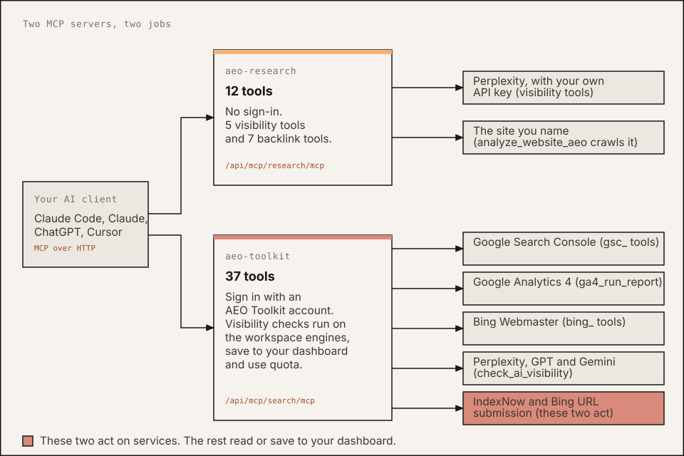

## Who it is for

Anyone who wants to know whether AEO work produces visits, and which pages earn them.

## The job

Count sessions that arrive from AI assistants, rank the landing pages they reach, and compare their quality with other traffic.

## Tools and skills

On the **aeo-toolkit** server. Sign in with your AEO Toolkit account and connect Google on your project.

- `list_ga4_properties` lists the GA4 properties you can read.
- `ga4_run_report` runs a report. It takes `propertyId`, `dateRanges`, `dimensions`, `metrics` and `limit`. It has no filter argument, so you filter the returned rows yourself.

The method and the referrer regex are in the [`aeo-ai-referral-analytics` skill](../../skills/aeo-ai-referral-analytics/SKILL.md).

## Steps

1. Call `list_ga4_properties` and confirm the property with the owner. Do not guess the ID.
2. Run `ga4_run_report` over at least 28 days. Use dimensions `sessionSource` and `sessionMedium`, metrics such as `sessions` and `engagedSessions`, and a high `limit` so the long tail is not cut.
3. Match AI sources with the regex in the skill. Also list sources that almost match and any unfamiliar source with `ai`, `gpt`, `chat` or `claude` in the name. Review them yourself. New assistants appear faster than any list.
4. Re-run with `landingPage` added. Filter to the AI sources and rank pages by sessions.
5. Compare engaged sessions per session, and key events, against organic search. With fewer than about 30 AI sessions, say the comparison is too thin.
6. Repeat weekly only if the volume supports a trend.

## What you get

- "At least N sessions" from AI assistants, with the denominator: AI sessions as a share of all sessions, both counts shown.
- The pages assistants actually send people to.

The GA4 tools live on the account server, which signs in with your AEO Toolkit account.

## Limits

- The number is a floor. Readers who see your brand in an answer and later type your URL arrive as direct or organic.
- Copied links, in-app browsers and some privacy settings drop the referrer.
- Assistants that do not tag their links cannot be identified in GA4.
- Do not apply a correction multiplier. There is no verified one.
- A visit does not show that an AEO change caused it.
