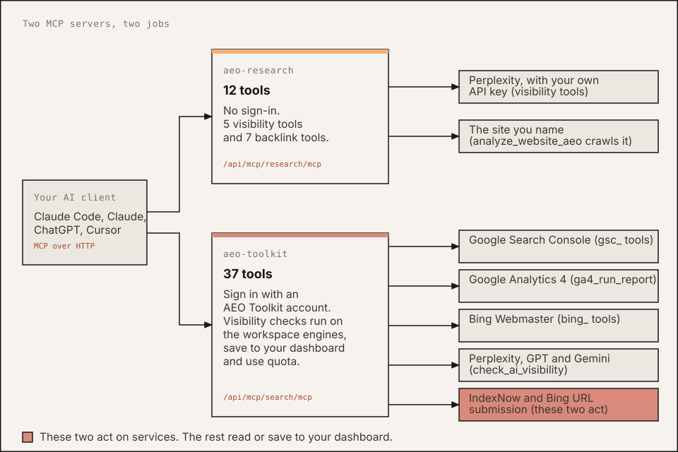

## Who it is for

A marketer or link builder who wants more third-party mentions, in the hope that answer engines cite the site more often.

## The job

Find credible sites worth approaching. Draft honest outreach. Confirm the links that land.

## Tools and skills

Seven backlink tools on the **aeo-research** server, no sign-in:

- `find_competitor_link_sources` approximates pages that link to a competitor, from free web-search signals. It is not a full backlink index.
- `find_mentions` splits mentions of a brand into linked and unlinked.
- `find_prospects` finds guest-post, resource-page and roundup targets for a topic.
- `check_page_history` returns a Wayback Machine timeline, so you can see whether a site is established.
- `extract_contact_info` reads emails and social handles from one page.
- `generate_outreach_email` drafts a short email with your own model provider key.
- `verify_page_links` checks whether a page links to your domain, with anchor text and `rel` values.

The search-backed tools draw on a small daily search budget per caller. When it runs out, the tool says to try again tomorrow, so choose targets before you spend it.

The method is in the [`aeo-citation-earning` skill](../../skills/aeo-citation-earning/SKILL.md).

## Steps

1. Run `compare_competitor_visibility` (see [Perplexity citations vs competitors](perplexity-citations-vs-competitors.md)) to find rivals that are cited where you are not.
2. Call `find_competitor_link_sources` on those rivals. Read the pages. Treat them as leads.
3. Call `find_mentions` with your brand and domain. Unlinked mentions are the easiest request.
4. Call `find_prospects` with your topic. Use `check_page_history` to drop link farms and brand-new sites.
5. Keep a prospect only if it is relevant, looks like a real publication and you have something worth linking to.
6. Run `extract_contact_info` on the target's own contact or team page only. Record where and when you found each contact and why they are relevant.
7. Draft with `generate_outreach_email`, then edit it by hand. Add the specific thing you liked on their page. Never send drafts unreviewed.
8. When a placement goes live, call `verify_page_links` and confirm the link, the anchor and the `rel` values.

## What you get

A ranked list of targets with the evidence for each, a draft email per target, and a verified yes or no for each link.

These tools sit on the research server, which needs no sign-in.

## Limits

- No tool can promise a citation. Report before and after citation rates with the number of runs, as in the Perplexity use case.
- Contact harvesting must follow anti-spam law, for example CASL in Canada. Use a contact only for a reason tied to their content, identify yourself and honour opt-outs.
- If money or product changes hands, the link must carry `rel="sponsored"`.
- On the aeo-research server, `generate_outreach_email` needs your own model key on each call. On the aeo-toolkit server it can use a key saved in your workspace settings.
