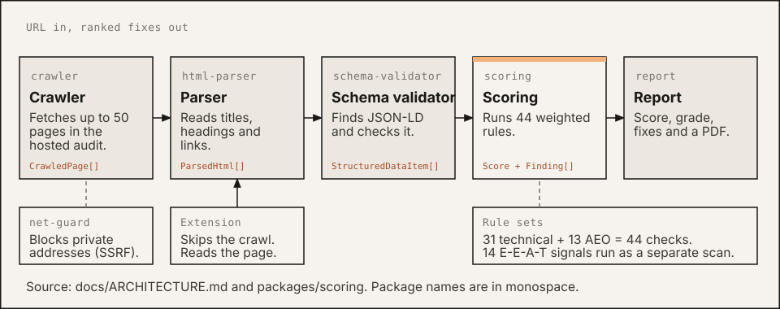

## Who it is for

A developer who owns a site's code and wants an agent to fix what an AEO audit flags.

## The job

Turn a list of failing rules into code changes in your stack, then prove each change landed.

## Tools and skills

- `analyze_website_aeo` on the **aeo-research** server. It crawls 10 pages and returns at most the top 8 fixes.
- The Claude Code plugin, which installs 24 skills and both servers: `/plugin install aeo-toolkit --marketplace Advance-Labs/aeo-toolkit`.
- Every audit rule has exactly one owning skill. The ones you will use most for code:
  - [`aeo-structured-data-validation`](../../skills/aeo-structured-data-validation/SKILL.md) for invalid, duplicate or conflicting JSON-LD
  - [`aeo-server-rendering`](../../skills/aeo-server-rendering/SKILL.md) for content that only exists after JavaScript runs
  - [`aeo-organization-entity`](../../skills/aeo-organization-entity/SKILL.md) for Organization markup and a stable `@id`
  - [`aeo-article-author-schema`](../../skills/aeo-article-author-schema/SKILL.md) for Article and Person author markup
  - [`aeo-faq-qa-schema`](../../skills/aeo-faq-qa-schema/SKILL.md) for FAQPage, QAPage and HowTo
  - [`aeo-page-metadata`](../../skills/aeo-page-metadata/SKILL.md) for titles, descriptions and Open Graph
- The rule definitions are listed under [audit rules](../rules/technical-seo.md) and [AEO rules](../rules/aeo.md).

## Steps

1. Install the plugin and open your repo in Claude Code.
2. Ask the agent to run the [`aeo` skill](../../skills/aeo/SKILL.md) on your site. It calls `analyze_website_aeo`, groups the failures and orders them by impact.
3. For each group, the owning skill follows the same loop: detect with the rule, decide whether it is a real problem, implement the recipe for your framework, then verify with the same check.
4. For rendering, test what the server sends rather than what the browser shows. Fetch the page with `curl` and look for your content in the raw HTML. If it is missing, the skill covers SSR, static generation and prerendering for your framework.
5. For structured data, validate that each JSON-LD block parses and that the visible page matches the markup. The `aeo-structured-data-validation` skill covers duplicates from plugins and colliding `@id` values.
6. Deploy, then run `analyze_website_aeo` again. The failing rule should now pass.

## What you get

Code changes in your repo, one group at a time, and a re-run of the same check as proof.

The audit that finds these failures runs this pipeline. The extension skips the crawl and reads the rendered page.

## Limits

- `analyze_website_aeo` is a shortlist. A rule that is not in the top 8 can still fail. Use the hosted audit for the full list.
- A passing audit does not mean AI will cite you. Measure that separately, as in [Perplexity citations vs competitors](perplexity-citations-vs-competitors.md).
- The agent edits your code. Review each diff.
